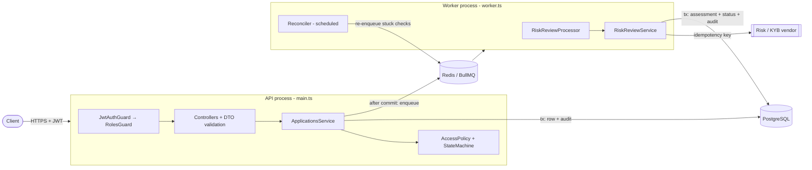
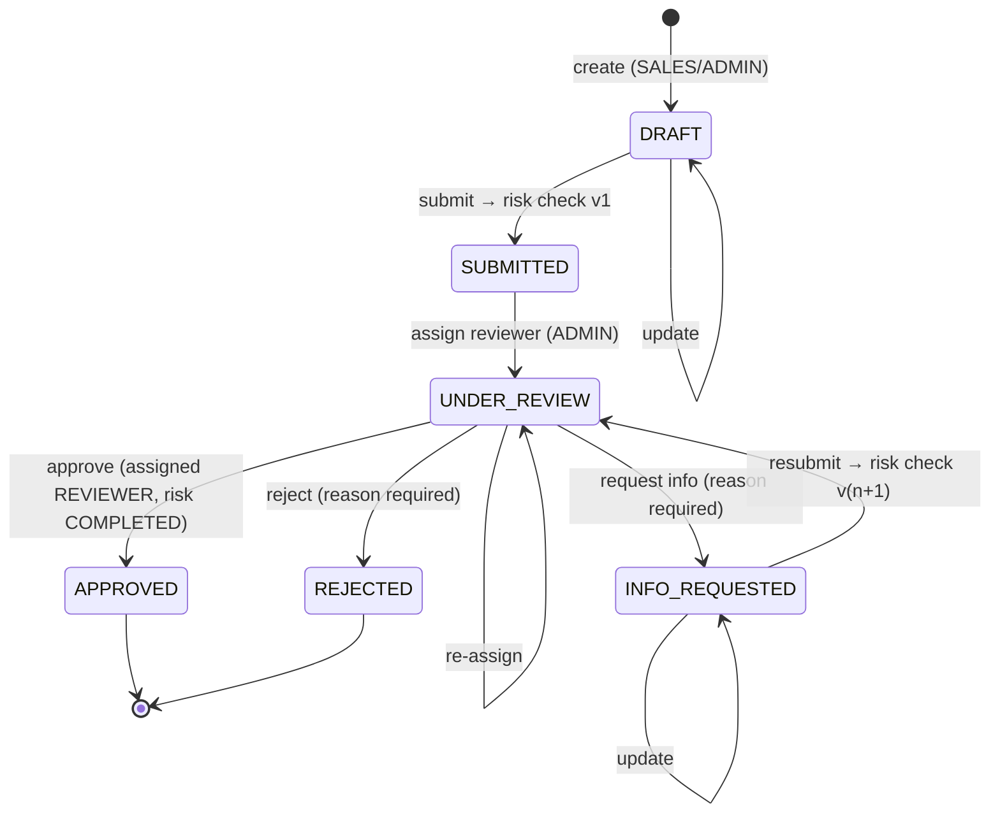

# Merchant Onboarding API

Backend for onboarding merchants onto a payments platform. Sales staff capture merchant
applications, an asynchronous worker runs a third-party risk/KYB check, and an assigned reviewer
approves, rejects or requests more information. Every significant action is written to an
append-only audit trail.

**Stack:** NestJS 11 · TypeScript (strict) · PostgreSQL 16 + TypeORM (reviewed migrations) ·
Redis 7 + BullMQ · JWT · OpenAPI/Swagger · Jest + Supertest + Testcontainers · Docker Compose

---

## Contents

1. [Quick start](#1-quick-start)
2. [Running tests](#2-running-tests)
3. [Architecture](#3-architecture)
4. [Domain model & lifecycle](#4-domain-model--lifecycle)
5. [Authorization](#5-authorization)
6. [Asynchronous risk review](#6-asynchronous-risk-review)
7. [Data model](#7-data-model)
8. [Security & sensitive data](#8-security--sensitive-data)
9. [API reference](#9-api-reference)
10. [Trade-offs & what I would do next](#10-trade-offs--what-i-would-do-next)
11. [AI assistance disclosure](#11-ai-assistance-disclosure)

---

## 1. Quick start

Prerequisites: Docker (with Compose v2), Node.js ≥ 20 (22 recommended, see `.nvmrc`), `openssl`.

```bash
npm ci
npm run env:init                 # creates .env with freshly generated random secrets (never committed)
docker compose up -d --build     # postgres, redis, migrate (one-shot), api, worker
docker compose run --rm api node dist/database/seeds/seed.js   # demo users (dev only)
```

- Swagger UI: <http://localhost:3000/docs>
- Readiness: <http://localhost:3000/api/v1/health/ready>

`npm run env:init` prints the demo password (also stored as `SEED_USER_PASSWORD` in `.env`). It is
shared by the seeded users:

| Role     | Email                                                    |
| -------- | -------------------------------------------------------- |
| ADMIN    | `admin@example.test`                                     |
| REVIEWER | `reviewer.one@example.test`, `reviewer.two@example.test` |
| SALES    | `sales.one@example.test`, `sales.two@example.test`       |

> If ports 5432/6379/3000 are already in use on your machine, change `DATABASE_PORT`, `REDIS_PORT`
> or `PORT` in `.env`. They only affect the host-side port mapping.

### Walkthrough (curl)

```bash
B=http://localhost:3000/api/v1
PW=$(grep ^SEED_USER_PASSWORD= .env | cut -d= -f2)
login() { curl -s $B/auth/login -H 'content-type: application/json' \
  -d "{\"email\":\"$1\",\"password\":\"$PW\"}" | node -pe 'JSON.parse(require("fs").readFileSync(0)).accessToken'; }
SALES=$(login sales.one@example.test); ADMIN=$(login admin@example.test); REVIEWER=$(login reviewer.one@example.test)

# 1. SALES creates a draft
ID=$(curl -s $B/applications -H "authorization: Bearer $SALES" -H 'content-type: application/json' -d '{
  "businessName":"Test Cafe","legalBusinessName":"Test Cafe Pvt. Ltd.","businessType":"PRIVATE_LIMITED",
  "taxId":"TEST-000123","countryCode":"NP","ownerFullName":"Test Owner","ownerEmail":"owner@example.test",
  "ownerPhone":"+9779800000000","merchantCategoryCode":"5814","expectedMonthlyVolume":50000,
  "averageTransactionAmount":25.5,"currency":"NPR"}' | node -pe 'JSON.parse(require("fs").readFileSync(0)).id')

# 2. SALES submits -> 202, riskStatus=PENDING, a risk job is enqueued
curl -s -X POST $B/applications/$ID/submit -H "authorization: Bearer $SALES"

# 3. ADMIN assigns a reviewer
REVIEWER_ID=$(curl -s $B/auth/me -H "authorization: Bearer $REVIEWER" | node -pe 'JSON.parse(require("fs").readFileSync(0)).id')
curl -s -X POST $B/applications/$ID/assign -H "authorization: Bearer $ADMIN" \
  -H 'content-type: application/json' -d "{\"reviewerId\":\"$REVIEWER_ID\"}"

# 4. After the worker finishes (riskStatus=COMPLETED), the assigned reviewer decides
curl -s -X POST $B/applications/$ID/decision -H "authorization: Bearer $REVIEWER" \
  -H 'content-type: application/json' -d '{"decision":"APPROVE"}'

# 5. ADMIN inspects the audit trail
curl -s "$B/audit-logs?entityId=$ID" -H "authorization: Bearer $ADMIN"
```

The simulated vendor fails 20% of calls on purpose (`RISK_PROVIDER_TRANSIENT_FAILURE_RATE`), so
you can watch retries in `docker compose logs -f worker`.

### Running the Node processes on the host (hot reload)

```bash
docker compose up -d postgres redis
set -a; . ./.env; set +a         # the TypeORM CLI reads plain env vars
npm run migration:run && npm run seed
LOG_PRETTY=true npm run start:dev          # API
LOG_PRETTY=true npm run start:worker:dev   # worker (second terminal)
```

---

## 2. Running tests

```bash
npm test              # unit tests: pure domain rules, no I/O (~58 tests, seconds)
npm run test:e2e      # integration/API tests: real PostgreSQL + Redis via Testcontainers (~52 tests)
npm run test:cov      # unit coverage
npm run lint && npm run typecheck
npm run migration:check   # fails if the entities and migrations have drifted (needs a migrated DB)
```

The integration tests need **only Docker**; they start throw-away containers, apply the real
migrations and boot the real API **and** the real BullMQ worker in-process. Only the third-party
vendor is replaced, by a scriptable fake (`test/support/fake-risk-provider.ts`) that can fail
transiently, fail permanently or hold a call open.

| Suite | What it proves |
| ----- | -------------- |
| `auth.e2e-spec.ts` | Login, identical errors for unknown user / wrong password, forged / `alg:none` / expired tokens rejected, **role claims in tokens are not trusted**, deactivation revokes access immediately, role guards |
| `applications-authorization.e2e-spec.ts` | **SALES cannot read, update, submit or list another user's application by id (404)**; cannot assign or approve; mass-assignment blocked; reviewers can't see drafts; **only the assigned reviewer** may decide (not other reviewers, not admins) |
| `applications-lifecycle.e2e-spec.ts` | Full lifecycle including request-info → resubmit; invalid transitions → 409; approval blocked until risk completes; pagination/filtering; tax id encrypted at rest; audit trail complete, immutable and free of secrets; request id propagated into async job audit rows |
| `risk-review.e2e-spec.ts` | Results persisted; transient failures retried with backoff; exhaustion → FAILED + audit + admin retry; permanent errors not retried; duplicate enqueue ignored; **concurrent redelivery records exactly once**; superseded checks discarded; reconciler recovers a lost job |

Unit tests cover the state machine (every allowed and forbidden transition), the access policy,
redaction/masking, AES-GCM encryption (round-trip, tamper detection, wrong key) and risk scoring.

---

## 3. Architecture



- **Two processes, one image** ([ADR-0001](docs/adr/0001-modular-monolith-with-separate-worker-process.md)):
  the API and the worker scale and fail independently.
- **Layering:** controllers handle HTTP only. Services orchestrate transactions. The *domain* layer
  (`*.policy.ts`, `*-state-machine.ts`, `risk-scoring.ts`) is pure TypeScript with no framework
  imports, so business rules are unit-testable in isolation.
- **Cross-cutting concerns:** global guards (authentication, then role), a global `ValidationPipe`
  (whitelist + forbid unknown fields), and a global exception filter. Services throw framework-agnostic
  `DomainError`s, and the filter maps them to HTTP status codes in one place, which keeps the
  worker free of HTTP concepts.
- **Consistent error envelope:** `{ statusCode, code, message, details?, requestId, path, timestamp }`.
- **Observability:** structured JSON logs (pino) with redaction; an `X-Request-Id` correlation id
  flows from HTTP → audit rows → queue job → worker audit rows; liveness and readiness probes.

```
src/
├── main.ts / worker.ts            # two entrypoints
├── app.module.ts / worker.module.ts
├── app.setup.ts                   # HTTP pipeline (shared with e2e tests)
├── config/                        # typed config + Joi env validation (fail fast)
├── infrastructure/                # config, logger, TypeORM, BullMQ root wiring
├── common/                        # errors, filter, decorators, crypto, redaction, request context
├── database/                      # data source, hand-written migration, dev seed
└── modules/
    ├── auth/                      # login, JWT guard, roles guard
    ├── users/                     # users, roles, admin user management
    ├── applications/              # lifecycle use-cases
    │   └── domain/                # entity, enums, state machine, access policy (pure)
    ├── risk-review/               # queue producer, worker, vendor port + simulator, reconciler
    ├── audit/                     # append-only audit trail
    └── health/                    # liveness / readiness
```

---

## 4. Domain model & lifecycle



The lifecycle is a single declarative table in
[`application-state-machine.ts`](src/modules/applications/domain/application-state-machine.ts).
Anything not in the table is an invalid transition (**409 `INVALID_STATE_TRANSITION`**). Business
preconditions beyond the graph give **422 `BUSINESS_RULE_VIOLATION`** (e.g. approving before the
risk check has completed, or assigning a user who isn't a reviewer).

Risk status is tracked separately from the workflow status:
`NOT_STARTED → PENDING → COMPLETED | FAILED`, plus `riskLevel` (LOW/MEDIUM/HIGH) and `riskScore`
(0–100). Rejecting or requesting info is allowed while the risk check is still pending, so a
reviewer is never blocked by a slow vendor. Approval is not.

Every state change follows the same recipe inside one DB transaction:
**load within the caller's scope `FOR UPDATE` → check object permission → compute next status →
save + write the audit row**. Side effects outside the database (enqueueing) happen only after commit.
Row locks serialise concurrent decisions, so two reviewers' clicks cannot both apply.

Key invariants are enforced a second time by the database through `CHECK` constraints: an approved
application must have `risk_status = COMPLETED` and `decided_at`; any status past `SUBMITTED`
must have a reviewer.

---

## 5. Authorization

Three layers ([ADR-0002](docs/adr/0002-object-level-authorization-in-the-query.md)):

1. **Authentication:** a global JWT guard, deny by default. The user is re-loaded from the database
   on each request, so role claims in tokens are never trusted.
2. **Roles:** `@Roles()` with a global `RolesGuard`.
3. **Object level:** `ApplicationAccessPolicy` adds a visibility predicate **to the SQL of every
   read and every locked update**. An application outside the caller's scope is simply not found
   (**404**), so ids belonging to other users are not even confirmed to exist. Actions on visible
   rows that aren't permitted return **403**.

| Action                          | ADMIN | SALES    | REVIEWER                 |
| ------------------------------- | :---: | :------: | :----------------------: |
| Create application              | ✅    | ✅       | ❌                       |
| Read / list                     | all   | own      | non-draft                |
| Update / submit                 | ✅    | own      | ❌                       |
| Assign reviewer                 | ✅    | ❌       | ❌                       |
| Approve / reject / request info | ❌    | ❌       | **assigned only**        |
| Retry failed risk review        | ✅    | ❌       | ❌                       |
| Users, audit log                | ✅    | ❌       | ❌                       |

---

## 6. Asynchronous risk review

Details and alternatives are in [ADR-0003](docs/adr/0003-reliable-async-risk-review.md).

1. `submit` commits `riskStatus = PENDING` and increments `riskCheckVersion`, **then** enqueues
   job `assess-<id>-v<version>`.
2. The worker loads the application. It skips the job if the check was superseded or already
   completed, then calls the vendor **outside** any transaction, passing the job id as the
   vendor's idempotency key.
3. In one transaction, the worker locks the row, re-checks, inserts the `risk_assessments` row
   (`ON CONFLICT DO NOTHING` on `(application_id, check_version)`), updates the application and
   writes the audit row.

| Concern | Mechanism |
| ------- | --------- |
| Duplicate enqueue (double-click, reconciler) | Deterministic BullMQ job id |
| Redelivery / concurrent workers | Version pre-check → `SELECT … FOR UPDATE` re-check → unique constraint |
| Stale results after a resubmit | Results apply only if `riskCheckVersion` still matches |
| Transient vendor errors | Retries with exponential backoff and jitter (default 5 attempts, 2 s base) |
| Permanent vendor errors | `UnrecoverableError`: no retries, marked `FAILED` immediately |
| Retries exhausted | Marked `FAILED` + audited; ADMIN can `POST /risk-review/retry` (new version) |
| DB committed but enqueue lost | Reconciler (BullMQ job scheduler) re-enqueues stuck `PENDING` checks |
| Worker shutdown | `enableShutdownHooks`: in-flight jobs finish; stalled jobs are re-delivered by BullMQ |
| Redis durability | AOF enabled, `noeviction` policy (required by BullMQ) |

The vendor is behind a `RiskProvider` port. `SimulatedRiskProvider` adds latency, a configurable
transient failure rate and a deterministic rules-based score (high-risk MCCs, volume, ticket size,
business type).

---

## 7. Data model

Schema: a single hand-written, reviewed migration:
[`1759900000000-InitialSchema.ts`](src/database/migrations/1759900000000-InitialSchema.ts).
`synchronize` is always off. The entities declare every index and check constraint as well, and
`npm run migration:check` (TypeORM's diff) confirms there is **no drift** between entities and
migrations.

| Table | Notes |
| ----- | ----- |
| `users` | Unique lower-cased email (`CHECK email = lower(email)`), bcrypt hash, role enum, `is_active` |
| `merchant_applications` | Business profile, owner contact, requested processing (`numeric` money, ISO-coded currency/country, MCC), workflow + risk state, `risk_check_version`, FKs to creator/reviewer (`RESTRICT`). Indexes match query patterns: `(status, created_at)`, `(created_by_id, created_at)`, `(assigned_reviewer_id, status)`, partial index for `PENDING` risk checks |
| `risk_assessments` | One row per check; `UNIQUE (application_id, check_version)`; score/level/reason codes; attempt number |
| `audit_logs` | `actor_id` (NULL = system), action enum, entity type/id, redacted `jsonb` metadata, `request_id`. Append-only, enforced by a trigger; deliberately no FKs, so audit history outlives the rows it describes |

PostgreSQL enums are used for closed vocabularies, `timestamptz` everywhere, UUID primary keys
(`gen_random_uuid()`), and `CHECK` constraints for value domains (score 0–100, positive amounts,
MCC/currency/country formats).

---

## 8. Security & sensitive data

See **[docs/SECURITY.md](docs/SECURITY.md)** for the full write-up, including the
**sensitive-field inventory and which fields require field-level encryption**. Highlights:

- No committed secrets: `.env` is generated locally, tests use ephemeral keys, and the app fails to
  boot with missing or weak secrets.
- **Tax id is encrypted at rest with AES-256-GCM**, using a versioned format to allow key rotation.
  It is masked in responses and audit metadata.
- Passwords and tokens never appear in logs or the audit trail. Logs (pino `redact`) and audit
  metadata (`redact()`) strip secrets and mask PII. Updates record changed field *names*, not values.
- Login: a timing-equalised bcrypt compare, generic errors and rate limiting. JWT: algorithm,
  issuer and audience are pinned, with a 15-minute lifetime.
- Helmet, strict DTO whitelisting (no mass assignment), UUID validation, a non-root container,
  and Postgres/Redis bound to localhost.

---

## 9. API reference

Base path `/api/v1`. Interactive docs are at `/docs` (OpenAPI 3, bearer auth).

| Method | Path | Roles | Description |
| ------ | ---- | ----- | ----------- |
| POST | `/auth/login` | public | Email/password → JWT (rate-limited) |
| GET | `/auth/me` | any | Current principal |
| POST | `/users` | ADMIN | Create user |
| GET | `/users?role=` | ADMIN | List users |
| POST | `/applications` | SALES, ADMIN | Create (DRAFT) |
| GET | `/applications?status=A,B&riskStatus=&assignedReviewerId=&page=&limit=` | any (scoped) | List with filters and pagination |
| GET | `/applications/:id` | any (scoped) | Get one |
| PATCH | `/applications/:id` | SALES (own), ADMIN | Update while DRAFT / INFO_REQUESTED |
| POST | `/applications/:id/submit` | SALES (own), ADMIN | Submit / resubmit → 202, enqueues risk check |
| POST | `/applications/:id/assign` | ADMIN | Assign / re-assign reviewer |
| POST | `/applications/:id/decision` | assigned REVIEWER | `APPROVE` \| `REJECT` \| `REQUEST_INFO` (+ `reason`) |
| POST | `/applications/:id/risk-review/retry` | ADMIN | Re-run a FAILED risk check → 202 |
| GET | `/applications/:id/risk-assessments` | any (scoped) | Risk check history |
| GET | `/audit-logs?entityId=&actorId=&action=` | ADMIN | Query the audit trail |
| GET | `/health/live`, `/health/ready` | public | Liveness / readiness (DB + Redis) |

---

## 10. Trade-offs & what I would do next

**Deliberate trade-offs within the time-box**

- **Reconciler instead of a transactional outbox:** the application row already acts as the outbox
  (`PENDING` + version). See ADR-0003 for when I'd switch.
- **Audit log in PostgreSQL** (explicitly allowed by the brief). It is written in the *same
  transaction* as the change, which a separate MongoDB store could not guarantee without an outbox.
- **Polling instead of push:** clients poll `GET /applications/:id` for risk completion.
  Webhooks were an optional enhancement and were skipped to keep the core solid.
- **Offset pagination:** simple and fine at this scale. Keyset pagination on
  `(created_at, id)` would be the next step for large tables.
- **Access tokens only:** no refresh tokens or revocation list. Tokens are short-lived and the user
  is re-checked on every request, which covers deactivation.
- **Login throttling is in-memory (per instance):** production would use the Redis throttler storage.
- **Money stored as `numeric(14,2)`** and exposed as JSON numbers. A multi-currency ledger would use
  integer minor units with currency-aware scale.
- Reviewers can view all non-draft applications (a review queue). Restricting them to assigned
  applications only is a one-line change to the policy predicate.

**Next steps**

1. Field-level encryption for the remaining PII (owner email/phone/name) with blind indexes; KMS
   envelope encryption.
2. Webhook from the risk vendor (HMAC signature + timestamp validation, idempotency on event id),
   replacing the simulated synchronous call.
3. A transactional outbox for domain events (notifications, webhooks to merchants).
4. Four-eyes approval for HIGH-risk merchants; an SLA timer for applications stuck in review.
5. OpenTelemetry tracing across API → queue → worker; queue metrics and alerts (failed-job rate,
   queue lag, reconciler repairs); a Bull Board admin UI.
6. Refresh-token rotation; Redis-backed rate limiting; per-user lockout.
7. Contract tests from the OpenAPI spec; load tests for the list endpoints.

---

## 11. AI assistance disclosure

An AI coding assistant (Claude Code) was used during development to speed up scaffolding,
boilerplate (DTOs, Swagger decorators, test setup) and drafting documentation. All design decisions
(state machine, authorization strategy, idempotency layers, schema and constraints) were reviewed
and are owned by me, and I can explain every part of the codebase.

**Verification performed:**

- Read and reviewed all generated code; adjusted naming, structure and edge cases.
- `npm run lint` and `npm run typecheck` (strict TypeScript) are clean.
- 58 unit tests and 52 integration tests, run repeatedly against real PostgreSQL and Redis to rule
  out flakiness.
- `migration:generate --check` confirms entities and the hand-written migration match exactly.
- Manual end-to-end run of the Docker Compose stack: migrations, seeding, the full lifecycle via
  curl, cross-tenant access attempts, worker retries, the audit trigger rejecting `UPDATE`, and
  ciphertext verified in the database.
